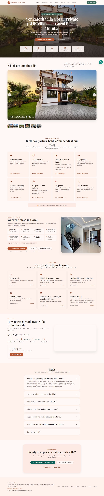

# Venkatesh Villa Gorai — website

A simple guide for the owner. No coding knowledge needed for the day-to-day stuff (changing photos, phone numbers, prices). The parts that do need a developer (hiring Codex/Claude again, or any web developer) are clearly marked **"ask a developer"**.

## 1. What this is

A one-page website for Venkatesh Villa Gorai: the villa's story, photo gallery, stays & celebrations info, nearby attractions, how to reach it, FAQs, and buttons to WhatsApp or call. There's no shopping cart, no login, no database — every enquiry goes straight to WhatsApp or a phone call.



---

## 2. See it on your own computer

You only need to do this once per computer.

1. **Install Node.js** (the free tool that runs this website's build). Go to [nodejs.org](https://nodejs.org) and download the "LTS" version. Click through the installer with the default options.
2. Open a terminal in this folder (in VS Code: right-click the folder → "Open in Integrated Terminal").
3. Type:
   ```
   npm install
   ```
   (This downloads everything the site needs. Only needed once, or after this file's dependencies change.)
4. Type:
   ```
   npm start
   ```
5. Open the web address it prints (usually `http://localhost:8080`) in your browser. You're now looking at a live preview — any file you save will refresh the page automatically.
6. Press `Ctrl+C` in the terminal to stop the preview when you're done.

---

## 3. Change carousel photos

The homepage photo carousel is controlled by one file: **`src/_data/gallery.json`**. You never need to touch any code to add, remove, reorder or caption a photo — pick whichever of the two ways below you're more comfortable with.

### (a) The free way: upload straight to GitHub

1. Go to the repository on github.com and open the folder `src/images/gallery`.
2. Click **Add file → Upload files**, drag in your new JPG/PNG/WebP photo(s), and commit.
3. That's it — a script runs automatically before every build and adds any new photo it finds to the carousel, with a reasonable guessed caption. The live site updates within about 2 minutes of your upload.
4. To delete a photo: delete it from `src/images/gallery` the same way (GitHub's file view → the photo → the trash icon). The build will notice it's gone and quietly remove it from the carousel instead of breaking.

### (b) The friendlier way: Pages CMS (a visual control panel)

1. Go to **[app.pagescms.org](https://app.pagescms.org)** and sign in with your GitHub account (the one this repository lives in).
2. Pick this repository. You'll see a screen listing "Carousel photos", "Business details", "Page text", "FAQ questions" and "Guest reviews" — these map to the `.pages.yml` file at the root of this project.
3. Open **Carousel photos**. You can drag to reorder, tick/untick "Show this photo on the site", pick which one is the main homepage photo ("Use as the homepage's main photo"), and type a caption and alt text for each.
4. Press **Save**. Pages CMS commits the change to GitHub for you, and the site rebuilds automatically.

*(If Pages CMS's screen doesn't quite match what's described above — it's a third-party tool and occasionally changes its own settings format — ask a developer to re-check `.pages.yml` against [pagescms.org/docs](https://pagescms.org/docs).)*

### (c) Doing it by hand in `gallery.json`

If you're comfortable editing a text file directly (on GitHub.com, click the file → the pencil/edit icon):

```json
{
  "file": "venkatesh-villa-gorai-front-dusk.png",
  "alt": "Venkatesh Villa Gorai facade at dusk",
  "caption": "Welcome to Venkatesh Villa Gorai",
  "show": true,
  "hero": true
}
```
- **Reorder photos**: cut and paste a whole `{ ... }` block earlier or later in the `"slides"` list.
- **Hide a photo without deleting it**: change its `"show"` to `false`.
- **Pick a different main homepage photo**: set `"hero": true` on the one you want (and `false` on the old one — only one photo should be `true`).
- **Change a caption**: edit the text after `"caption":`. Keep the quote marks.

---

## 4. Change text, phone numbers or prices

Everything you'd normally want to change lives in one of these plain-text files, inside `src/_data/`:

| What you want to change | File | What to edit |
|---|---|---|
| Phone number people call | `site.json` | `"phoneE164"` (used behind the scenes) and `"phoneDisplay"` (what's shown on screen) |
| WhatsApp number | `site.json` | `"whatsappNumber"` and `"whatsappDisplay"` — **these can be a different number from the Call number above**, on purpose |
| Address | `site.json` | the `"address"` section |
| Google Maps / Directions links | `site.json` | `"googleMapsUrl"` and `"googleDirectionsUrl"` |
| Instagram link | `site.json` | `"instagram"` |
| Check-in / check-out times | `site.json` | `"checkIn"` and `"checkOut"` |
| Whether prices are shown | `site.json` | `"showPrices"` — `true` or `false` |
| Homepage headline & intro text | `copy.json` | the `"hero"` section |
| Celebrations cards (birthday, haldi, etc.) | `copy.json` | the `"celebrations"` → `"cards"` list |
| FAQ questions & answers | `faq.json` | each `{ "question": ..., "answer": ... }` |
| Nearby attractions | `attractions.json` | each place's `"name"`, `"line"`, `"distance"` |
| Guest reviews | `reviews.json` | starts empty (`[]`) — see note below |

To edit any of these on GitHub.com: open the file, click the pencil icon, make your change between the quote marks, and commit. **Don't remove any quote marks, commas or curly braces** — if you're unsure, copy the whole file's text somewhere safe first so you can undo by pasting it back.

**About reviews:** `reviews.json` is empty on purpose — we never invent reviews. Once you have a real review (from Google or Airbnb), add it like this:
```json
{ "name": "Pooja", "source": "Google", "month": "September 2026", "rating": 5, "text": "Exact words from their real review." }
```
The Reviews section on the site only appears once this file has at least one entry.

**Things that need a developer to change** (ask Codex or Claude to help): adding a new page section, changing the visual design/colours, adding a new carousel caption style for a newly-named space in the villa, or anything involving the file `eleventy.config.js`.

---

## 5. Go live on GitHub Pages (free)

**Changing mobile wording:** `src/_data/copy.json` has shorter phone versions
in fields beginning with `mobile` (for example `mobileH1` and `mobileIntro`).
Nearby cards use `mobileLine` in `src/_data/attractions.json`. Edit these to
change phone copy without changing the desktop wording. The phone hero hides
the longer byline automatically; all screen sizes still use the same photos
and booking links.

Website address: **https://dubeysh18-sys.github.io/venkatesh-villa-gorai/**.
The repository is `dubeysh18-sys/venkatesh-villa-gorai`. GitHub Pages uses
GitHub Actions and HTTPS. Future pushes to `main` rebuild this address.
Keep `baseUrl` set to the full website address without a trailing slash,
including `/venkatesh-villa-gorai` while using this GitHub Pages address.

1. Make sure all your changes are committed and pushed to the `main` branch on GitHub.
2. On github.com, open this repository → **Settings → Pages**.
3. Under "Build and deployment" → **Source**, choose **GitHub Actions**.
4. Push anything to `main` (or just wait — the first push already triggers it). Open the **Actions** tab to watch it build; it takes a couple of minutes.
5. Once it's green, your site is live at `https://<your-github-username>.github.io/<repository-name>/`. GitHub shows you this exact address under Settings → Pages.

**Important — the site stays hidden from Google until you say so.** Right now `site.json` has `"indexable": false`, which tells search engines "don't index this page yet" (this is normal while you're still testing on the `github.io` address). Leave it as `false` until you've connected your real domain (next section) — then flip it to `true`.

---

## 6. Connect your own domain later

1. **Buy a domain** (e.g. from GoDaddy, Namecheap, Google Domains, etc.) — something like `venkateshvillagorai.com`.
2. **Add a `CNAME` file**: create a new file at `src/CNAME` containing just your domain, one line, nothing else, e.g.:
   ```
   venkateshvillagorai.com
   ```
3. **Update your DNS records** at wherever you bought the domain. GitHub's exact required IP addresses change occasionally, so check GitHub's current instructions at **Settings → Pages → Custom domain** on your repository (it'll tell you exactly what to add) — as of now it's 4 "A" records pointing at GitHub's IP addresses, plus a "CNAME" record for `www` pointing at `<your-username>.github.io`.
4. Back in **Settings → Pages**, type your domain into "Custom domain" and save. Wait for the green "DNS check successful" message, then tick **Enforce HTTPS**.
5. **Update two settings in `src/_data/site.json`:**
   - `"baseUrl"`: change it to `"https://venkateshvillagorai.com"` (your real domain, no trailing slash).
   - `"indexable"`: change it to `true`.
6. Commit and push. Once the site rebuilds, submit your sitemap (`https://venkateshvillagorai.com/sitemap.xml`) in [Google Search Console](https://search.google.com/search-console) and [Bing Webmaster Tools](https://www.bing.com/webmasters), and click "Request indexing" for your homepage.

---

## 7. After launch: SEO checklist (things you do, not code)

1. **Claim/verify the Google Business Profile that already exists** for "Venkatesh villa" — don't create a second listing, that hurts rankings.
   - Fix the "Located in: Margaret Villa" note if it's showing (use "Suggest an edit").
   - Add this website's address once it's live, with a tracking link like `https://venkateshvillagorai.com/?utm_source=gbp&utm_medium=organic`.
   - Make sure the phone number on the listing matches `phoneE164` in `site.json` exactly.
   - To officially rename the listing to "Venkatesh Villa Gorai", first put that exact name on the gate signboard — Google requires the real-world name to match first.
   - Category: pick **"Villa"** as the primary category if offered, "Event venue" as secondary.
   - Add 20+ real photos, list your services (Birthday party, Haldi, Mehendi, Team outing, Day picnic), and post updates weekly.
2. **Ask every real guest for a review.** Never post or pay for fake reviews — Google can detect this and penalize the listing.
3. **Keep your name, address and phone number identical** everywhere: Justdial, WedMeGood, Airbnb, Booking.com, MakeMyTrip, Instagram, Facebook.
4. Put the website link in your Instagram bio and WhatsApp Business profile.
5. Consider collaborating with local Mumbai travel Instagram creators — their reels are already showing up for "one day picnic Gorai" searches.

---

## 8. Troubleshooting

**The build failed (`npm run build` shows a red error).**
- Read the error message — it usually names the exact file and line.
- A common one: *"Missing alt text for image"* — every photo needs an `"alt"` description in `gallery.json`; this is required on purpose (for screen readers and Google), the build will not silently skip it.
- If it's a JSON file error (`Unexpected token`), you likely deleted a comma, quote or brace while editing — compare against a working file's structure, or undo your last edit.
- Try `npm install` again in case a dependency is missing, then re-run `npm run build`.

**A photo isn't showing on the live site.**
- Check its file extension is `.jpg`, `.jpeg`, `.png` or `.webp` (other formats aren't picked up automatically).
- Check `"show": true` for that photo in `gallery.json`.
- Give it a minute or two — the GitHub Action needs to finish rebuilding after you push.

**The WhatsApp/link preview has no image, or shows the wrong one.**
- This only works once `site.json`'s `"baseUrl"` is set to your real, public `https://...` address (not `localhost` or the placeholder `example.com`) — link previews need to fetch the image from a public URL.
- The preview image is generated automatically from your current main ("hero") carousel photo — change which photo is `"hero": true` to change it.
- Some apps (WhatsApp in particular) cache old previews. Share the link again after a few minutes, or use [Facebook's Sharing Debugger](https://developers.facebook.com/tools/debug/) to force a refresh.

**Something else is broken and you don't know why.**
- Open `HANDOFF.md` at the root of this project — it has a running log of what's been built, what's known to be unfinished, and the exact next step. Hand that file (along with this README and `AGENTS.md`) to a developer, Codex, or Claude Code, and say "continue from HANDOFF.md."

---

## For developers continuing this project

Read `AGENTS.md` (the original build spec) and `HANDOFF.md` (current progress + decisions) before changing anything. `DESIGN_NOTES.md` explains how the Stitch design reference was translated into code and every deliberate deviation from it.

```
npm install        # install dependencies
npm start           # local dev server with live reload, http://localhost:8080
npm run build        # production build to _site/
npm run check         # HTML validation + broken-link check over _site/
npm run check:lhci     # Lighthouse CI (needs a build first)
```
